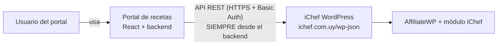
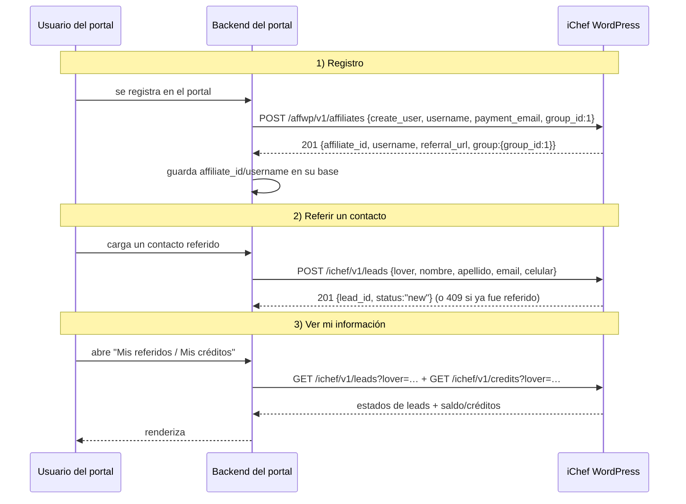

# 🔌 Conector del Portal de Recetas ↔ Módulo de Afiliados iChef

> **Para:** equipo de producción del portal de recetas (backend/React).
> **De:** equipo técnico del programa de afiliados iChef.
> **Fecha:** 2026-10-16 · **Versión:** 1.0
> **Documentos relacionados:** [`AFILIADOS-REFERENCIA.md`](AFILIADOS-REFERENCIA.md) (referencia técnica completa) · [`GUIA-IMPLEMENTACION-AFILIADOS.md`](GUIA-IMPLEMENTACION-AFILIADOS.md) (guía de negocio) · [`docs/postman/`](postman/) (requests listos para Bruno/Postman).

---

## 1. Objetivo

Conectar el portal de recetas con el programa de afiliados de iChef para que:

1. **Cada usuario nuevo del portal se registre como afiliado del grupo `Lovers`** (vía API).
2. **Cada Lover pueda registrar contactos referidos** (leads) desde el portal (vía API).
3. **Cada Lover pueda consultar su información**: créditos, referidos y estado de cada referido (vía API).

---

## 2. Arquitectura y regla de oro



> ⚠️ **REGLA DE ORO:** todas las llamadas a la API deben hacerse **desde el backend del portal** (server-side), **nunca desde el navegador**. Las credenciales son de un usuario administrador del sitio y **no deben exponerse al frontend** (ni en JS, ni en variables de entorno del cliente).

---

## 3. Entorno y autenticación

| Dato | Valor |
|---|---|
| **Base URL (producción)** | `https://ichef.com.uy/wp-json` |
| **Autenticación** | **HTTP Basic Auth** |
| **Usuario** | `{PUBLIC_KEY}` |
| **Contraseña** | `{TOKEN}` ← **es el Token, NO la Secret Key** |
| **Headers** | `Content-Type: application/json` · `Accept: application/json` |

> 🔐 Las credenciales reales se entregan **por canal seguro** (no van en este documento). Si se filtran, avisar a iChef para rotarlas.
> ⚠️ Usar **HTTPS siempre**. No hacer llamadas desde el navegador.

---

## 4. Flujo completo



---

## 5. Endpoint A — Alta del usuario del portal como afiliado Lover

**Cuándo:** cuando un usuario se registra en el portal (o si se decide hacerlo en otro momento, ej. al referir su primer contacto).

```http
POST /wp-json/affwp/v1/affiliates
Authorization: Basic {PUBLIC_KEY}:{TOKEN}
Content-Type: application/json
```

```json
{
  "create_user": "1",
  "username": "juanperez",
  "payment_email": "juan.perez@example.com",
  "status": "active",
  "group_id": 1
}
```

| Campo | Tipo | Requerido | Notas |
|---|---|---|---|
| `create_user` | string `"1"` | **sí** | Crea el usuario de WordPress del afiliado. |
| `payment_email` | string | **sí** | Email del usuario (se usa para crear la cuenta WP). |
| `username` | string | **recomendado** | Se usa para el link de afiliado (`/ref/<username>/`). **Enviarlo siempre**: limpio, sin espacios/acentos/`@`, único. Si se omite, el sistema lo deriva del email (puede quedar feo). |
| `status` | string | **sí** (`"active"`) | Sin esto, si el sitio pide aprobación, queda `pending`. |
| `group_id` | integer | **sí** (`1`) | `1` = **Lovers**. Con un ID inválido la API responde **400 y no crea nada**. |
| `rate` / `rate_type` | — | no | **No hace falta** para Lovers (su premio es el crédito fijo que maneja el módulo, ver §8). |

**Respuesta 201 (estructura — ejemplo):**

```json
{
  "affiliate_id": 1770,
  "user_id": 2101,
  "status": "active",
  "payment_email": "juan.perez@example.com",
  "group": { "group_id": 1, "title": "Lovers" },
  "username": "juanperez",
  "referral_url": "https://ichef.com.uy/ref/juanperez/",
  "id": 1770
}
```

✅ **Guardar en la base del portal:** `affiliate_id` y `username` (los van a necesitar para todo lo demás).
📭 **No se envían emails** al dar de alta por API (silenciado a propósito).

### Errores típicos del alta

| HTTP | `code` | Causa | Qué hacer |
|---|---|---|---|
| 400 | `existing_user_email` | El email **ya es un usuario de WordPress** | Ver “caso especial” abajo |
| 400 | `existing_user_login` | El `username` ya existe | Reintentar con otro username (ej. `juanperez-2`) |
| 400 | `rest_invalid_param` | `group_id` inválido | Usar `1` |
| 400 | `affwp_rest_affiliate_missing_user` | Faltan `user_id` o `create_user`+`payment_email` | Revisar el body |
| 401 | — | Credenciales mal/en falta | Revisar Basic Auth |
| 403 | `rest_forbidden` | Credencial sin permisos | Avisar a iChef |
| 500 | `affwp_rest_add_affiliate_error` | Fallo interno | Reintentar / avisar a iChef |

### ⚠️ Caso especial: el email ya existe (usuarios que ya compraron)

Si el email ya tiene cuenta de WordPress (p. ej. un cliente que compró antes), el alta directa va a fallar con `existing_user_email`. Flujo recomendado:

1. **Antes de crear**, verificar si ya es afiliado:
   ```
   GET /wp-json/affwp/v1/affiliates?search=<email>
   ```
   - Si **aparece** → ya está registrado: guardar `affiliate_id`/`username` y seguir (no crear de nuevo). *(Idempotencia.)*
   - Si responde `404 no_affiliates` → no es afiliado todavía.
2. Si al crear devuelve `existing_user_email` (email existe como usuario WP pero **no** es afiliado) → **avisar a iChef** con el email del usuario: el equipo lo resuelve en 1 minuto desde la pantalla **“Alta simplificada”** del módulo (que sí soporta usuarios existentes). *(Automatizarlo requeriría un endpoint extra — coordinar si molesta.)*

---

## 6. Endpoint B — Registrar un contacto referido (lead)

**Cuándo:** cuando el Lover carga un contacto referido desde el portal.

```http
POST /wp-json/ichef/v1/leads
Authorization: Basic {PUBLIC_KEY}:{TOKEN}
Content-Type: application/json
```

```json
{
  "lover": "juanperez",
  "nombre": "María",
  "apellido": "Gómez",
  "email": "maria.gomez@example.com",
  "celular": "099123456"
}
```

| Campo | Tipo | Requerido | Notas |
|---|---|---|---|
| `lover` | string | **sí** | **username, email o ID** del afiliado Lover. Debe estar **activo** y pertenecer al grupo Lovers. |
| `nombre` / `apellido` | string | **sí** | |
| `email` | string | **sí** | **Único en todo el programa**: si ya fue referido (por cualquiera), devuelve **409** y **no se registra**. |
| `celular` | string | **sí** | Se **normaliza automáticamente a formato internacional UY**: `099123456` → `59899123456`. También acepta `+598…`, `00598…`, fijos. |

**Respuesta 201:**

```json
{ "lead_id": 7, "status": "new", "created_at": "2026-10-16 10:15:42" }
```

📧 Al crearse el lead, **iChef recibe un aviso por email** (para asignarlo a un Partner comercial).
🔒 No permitir referirse a sí mismo: si el email del contacto es igual al del Lover, devuelve **400 `ichef_ll_self_referral`**.

### Errores típicos del lead

| HTTP | `code` | Causa | Qué mostrar en el portal |
|---|---|---|---|
| 400 | `ichef_ll_missing_lover` | Falta `lover` | Error de integración |
| 400 | `ichef_ll_lover_not_found` | No existe ese afiliado | Revisar el identificador |
| 400 | `ichef_ll_lover_inactive` | El Lover no está activo | “Tu cuenta de afiliado no está activa” |
| 403 | `ichef_ll_not_lover` | El afiliado no es del grupo Lovers | Error de integración |
| 400 | `ichef_ll_missing_name` / `ichef_ll_invalid_email` / `ichef_ll_invalid_phone` | Datos inválidos | Validar en el formulario |
| 400 | `ichef_ll_self_referral` | El contacto es el propio Lover | “No podés referirte a vos mismo” |
| **409** | **`ichef_ll_duplicate`** | **El email ya fue referido** | “Este contacto ya fue referido” (+ `same_lover`) |

**Respuesta 409 (ejemplo):**

```json
{
  "code": "ichef_ll_duplicate",
  "message": "Este contacto ya fue referido por otro afiliado.",
  "data": {
    "status": 409,
    "same_lover": false,
    "lead_id": 3,
    "lead_status": "assigned"
  }
}
```
> `same_lover: true` ⇒ ya lo refirió **el mismo Lover** (“Ya referiste a este contacto”).
> `same_lover: false` ⇒ lo refirió **otro** Lover (no revelar quién).

---

## 7. Endpoint C — Consultar los referidos y su estado

```http
GET /wp-json/ichef/v1/leads?lover=<username|email|id>&number=50&offset=0
```

| Query | Default | Notas |
|---|---|---|
| `lover` | — | **requerido** |
| `number` | 50 | máx. 200 |
| `offset` | 0 | paginación |

**Respuesta 200 (estructura):**

```json
{
  "lover": { "affiliate_id": 1770, "username": "juanperez" },
  "total": 12,
  "items": [
    {
      "id": 7,
      "nombre": "María Gómez",
      "email": "maria.gomez@example.com",
      "celular": "59899123456",
      "status": "credited",
      "partner": { "affiliate_id": 7, "username": "gstizzaw" },
      "campaign": "lead-7",
      "link": "https://ichef.com.uy/ref/gstizzaw/?campaign=lead-7",
      "credit_amount": 50,
      "created_at": "2026-10-16 10:15:42",
      "assigned_at": "2026-10-16 11:00:00",
      "purchased_at": "2026-10-16 15:30:00",
      "credited_at": "2026-10-16 18:00:00"
    }
  ]
}
```

### Estados del referido (qué mostrar en el portal)

| `status` | Significado | Texto sugerido para el portal |
|---|---|---|
| `new` | Entró el contacto; iChef todavía no lo asignó a un Partner | “Recibido — en revisión” |
| `assigned` | Ya tiene Partner comercial asignado (le compartió su link) | “Asignado — en gestión” |
| `purchased` | El contacto compró; el pedido aún no se completó | “Compró — acreditación pendiente” |
| `credited` | Pedido completado → **crédito acreditado** (USD 50) | “¡Acreditado!” |
| `void` | Pedido reembolsado/cancelado → crédito revertido | “Anulado” |

> `partner` es `null` mientras no haya asignación. `link` es el link de compra del Partner con la campaña del lead (útil para soporte; el Lover **no** necesita compartirlo).

---

## 8. Endpoint D — Consultar créditos

```http
GET /wp-json/ichef/v1/credits?lover=<username|email|id>
```

**Respuesta 200 (estructura):**

```json
{
  "lover": { "affiliate_id": 1770, "username": "juanperez" },
  "currency": "USD",
  "credit_per_lead": 50,
  "credits_available": 150,
  "credits_pending": 50,
  "leads": { "new": 2, "assigned": 1, "purchased": 1, "credited": 3, "void": 1 },
  "credits_enabled": true,
  "balance": 150,
  "movements": [
    { "date": "2026-10-16 18:00:00", "type": "lover_lead", "amount": 50, "status": "available", "lead_id": 7, "referral_id": 15, "order_id": 31458, "coupon_code": "", "note": "Premio por lead #7 acreditado" }
  ]
}
```

| Campo | Significado |
|---|---|
| `credits_available` / `balance` | **Saldo real** disponible (USD). Es el mismo valor. |
| `credits_pending` | Créditos “en camino”: contactos que compraron pero el pedido no se completó (× USD 50). |
| `leads` | Conteo de referidos por estado (para las tarjetas del portal). |
| `credit_per_lead` | Premio vigente por contacto acreditado (hoy **USD 50**). |
| `credits_enabled` | Si es `false`, el módulo de créditos está apagado (mostrar aviso). |
| `movements` | Últimos movimientos (emisiones, canjes, reversiones) con fecha, tipo, importe y estado. |

> 💡 Reglas de negocio: el crédito se **acredita** cuando el pedido del referido se completa y se **revierte** si el pedido se reembolsa/cancela (el saldo puede quedar negativo si ya se había canjeado).

### (Opcional) Datos generales del afiliado

```http
GET /wp-json/affwp/v1/affiliates/{affiliate_id|username}
```
Devuelve, entre otros: `group` (`{"group_id":1,"title":"Lovers"}`), `username`, `referral_url`, `status`, `date_registered`.

---

## 9. Endpoint E (opcional) — Canje de créditos

Si el portal quiere ofrecer **canje** (generar un cupón de compra con los créditos del Lover):

```http
POST /wp-json/ichef/v1/credits/redeem
Content-Type: application/json

{ "lover": "juanperez", "amount": 100 }
```

**Respuesta 201:**

```json
{ "code": "credito-juanperez-a1b2", "amount": 100, "coupon_id": 31450, "emails": ["juan.perez@example.com"] }
```

- El portal muestra el `code` y el Lover lo usa en el **checkout** de la tienda **con su email**.
- Reglas del cupón: monto libre **≥ USD 10** y **≤ saldo** · uso único · solo el email del afiliado · no combinable con otros cupones ni productos en oferta · **sin vencimiento**.
- El saldo se descuenta cuando el pedido pasa a *Procesando/Completado* (si el carrito es menor que el cupón, el resto queda disponible).
- Errores: `ichef_ll_amount_min` (400), `ichef_ll_insufficient` (400, incluye `balance`), `ichef_ll_no_email` (400), `ichef_ll_credits_off` (503).

---

## 10. Errores generales (formato WordPress REST)

Todas las respuestas de error tienen esta forma:

```json
{ "code": "…", "message": "…", "data": { "status": 400 } }
```

| HTTP | Significado | Recomendación |
|---|---|---|
| 400 | Datos inválidos | Mostrar el `message` al usuario / validar antes |
| 401 | Sin credenciales o inválidas | Error de configuración (revisar Basic Auth) |
| 403 | La credencial no tiene permisos | Avisar a iChef |
| 404 | Recurso vacío (p. ej. `no_affiliates`) | **No es un error real**: tratar como “sin datos” |
| 409 | Conflicto (lead duplicado) | Flujo normal: informar “ya referido” |
| 500 | Error interno | Reintentar; si persiste, avisar a iChef |

**Buenas prácticas:**
- Timeout sugerido: **15–20 s** · reintentos con backoff para 5xx/red.
- Cachear en el portal los **GET** (créditos/leads) unos minutos; no golpear la API en cada render.
- Loguear `code` + `message` + endpoint ante errores (sin loguear credenciales).

---

## 11. Pruebas (listo para usar)

En [`docs/postman/`](postman/) hay requests de **Bruno** (y una colección Postman) con estos flujos:

| Archivo | Flujo |
|---|---|
| `crear-afiliado-lovers.bru` | Alta de afiliado Lover (grupo 1) |
| `ichef-lead-crear.bru` | Crear referido (lead) |
| `ichef-leads-listar.bru` | Listar referidos + estados |
| `ichef-creditos-lover.bru` | Consultar créditos |
| `ichef-credito-canje.bru` | Canje (generar cupón) |

**cURL rápido (reemplazar credenciales):**

```bash
# 1) Alta de Lover
curl -u "{PUBLIC_KEY}:{TOKEN}" -H "Content-Type: application/json" \
  -d '{"create_user":"1","username":"prueba_lover","payment_email":"prueba_lover@example.com","status":"active","group_id":1}' \
  https://ichef.com.uy/wp-json/affwp/v1/affiliates

# 2) Crear referido
curl -u "{PUBLIC_KEY}:{TOKEN}" -H "Content-Type: application/json" \
  -d '{"lover":"prueba_lover","nombre":"Juan","apellido":"Pérez","email":"contacto_prueba@example.com","celular":"099123456"}' \
  https://ichef.com.uy/wp-json/ichef/v1/leads

# 3) Consultar
curl -u "{PUBLIC_KEY}:{TOKEN}" "https://ichef.com.uy/wp-json/ichef/v1/leads?lover=prueba_lover"
curl -u "{PUBLIC_KEY}:{TOKEN}" "https://ichef.com.uy/wp-json/ichef/v1/credits?lover=prueba_lover"
```

> ⚠️ **Probar contra producción crea usuarios y afiliados reales.** Coordinar con iChef: usar emails claramente identificables como prueba (ej. `prueba_*@example.com`) y avisar para dar de baja lo que se genere.

---

## 12. Checklist de integración

- [ ] Credenciales recibidas por canal seguro y configuradas **solo en el backend**.
- [ ] Alta de Lover funcionando (201 + guardar `affiliate_id`/`username`).
- [ ] Idempotencia: chequear `?search=<email>` antes de crear (y manejar `existing_user_email`).
- [ ] Creación de leads funcionando (201) y **manejo del 409** (ya referido).
- [ ] Listado de referidos con estados + paginación.
- [ ] Créditos (`balance`, `pending`, `movements`) visibles en el portal.
- [ ] Manejo de errores según §10 + timeouts + reintentos.
- [ ] (Opcional) Canje de créditos.
- [ ] Prueba end-to-end con un usuario real de prueba + validación con iChef.

---

## 13. Preguntas frecuentes

**¿El Lover necesita cuenta de WordPress?**
Sí: la API se la crea (`create_user: "1"`). Pero **no accede al panel de WordPress** — toda su experiencia es el portal. La contraseña WP es aleatoria y no se usa.

**¿Qué pasa si el mismo usuario se registra dos veces en el portal?**
Verificar antes con `GET /affwp/v1/affiliates?search=<email>`. Si ya existe, reutilizar su `affiliate_id`.

**¿Cuándo y cuánto gana el Lover?**
USD 50 fijos por **contacto que compra y cuyo pedido se completa** (`status: credited`). Se **revierte** si el pedido se reembolsa/cancela.

**¿El Lover comparte links?**
No: refiere **contactos** (formulario del portal). El link de afiliado existe (`referral_url`) pero quien lo comparte con el contacto es el **Partner comercial** asignado por iChef.

**¿Puedo crear el usuario del portal y el afiliado en un solo paso?**
Sí — es exactamente lo que hace el alta por API (`create_user` + `group_id: 1`).

**¿Hay rate limit?**
No está documentado. Usar cache para GETs y evitar loops de reintentos agresivos.

**¿Y si cambia la URL de la tienda o los estados?**
Este contrato es estable; cualquier cambio se comunicará con antelación. Referencia técnica completa: [`AFILIADOS-REFERENCIA.md`](AFILIADOS-REFERENCIA.md) §6.

---

*¿Dudas o bloqueos? Contactar al equipo técnico de iChef con: endpoint, request (sin credenciales), response y `code` del error.*
